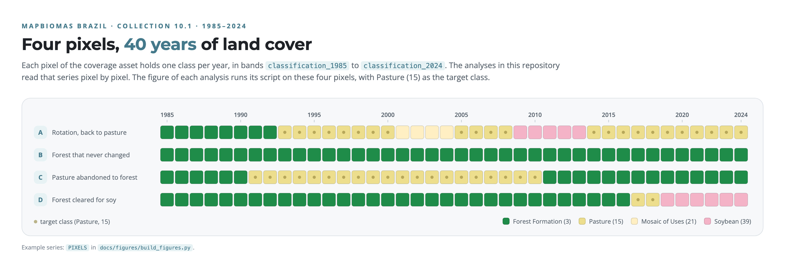
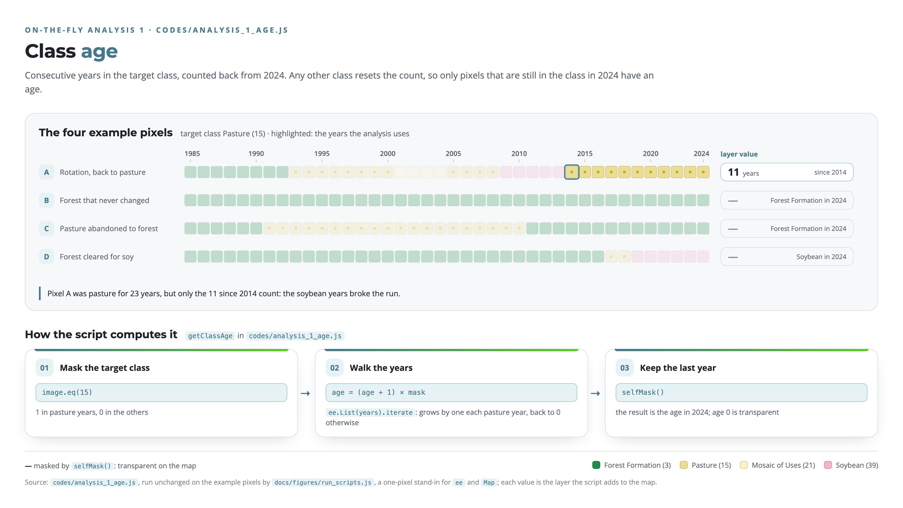
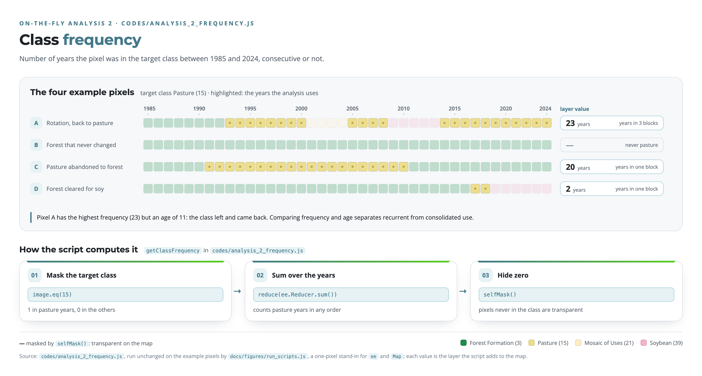
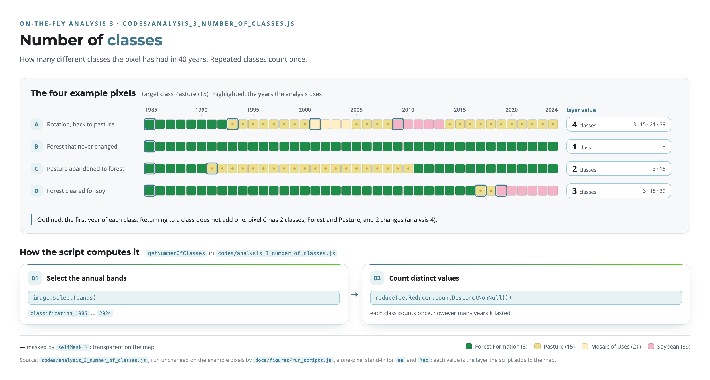
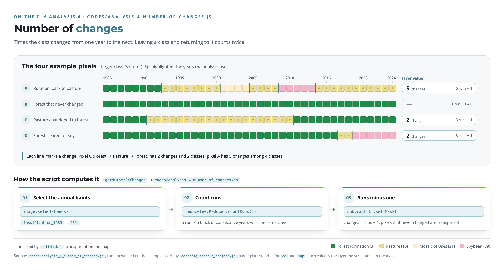
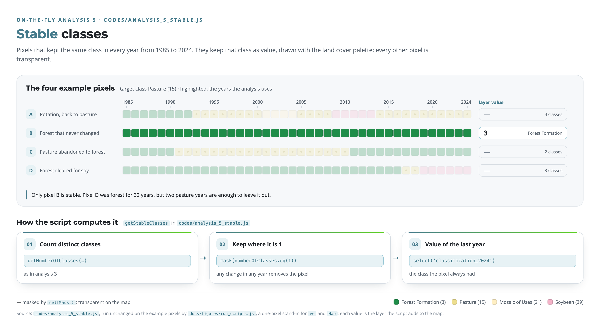
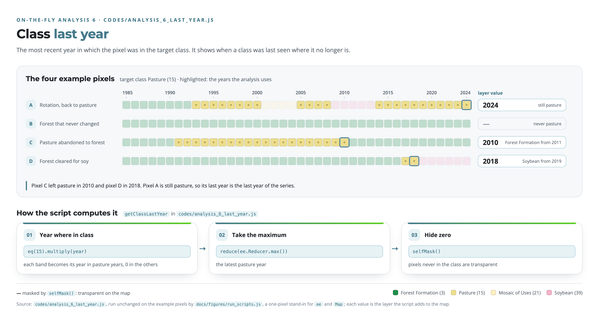
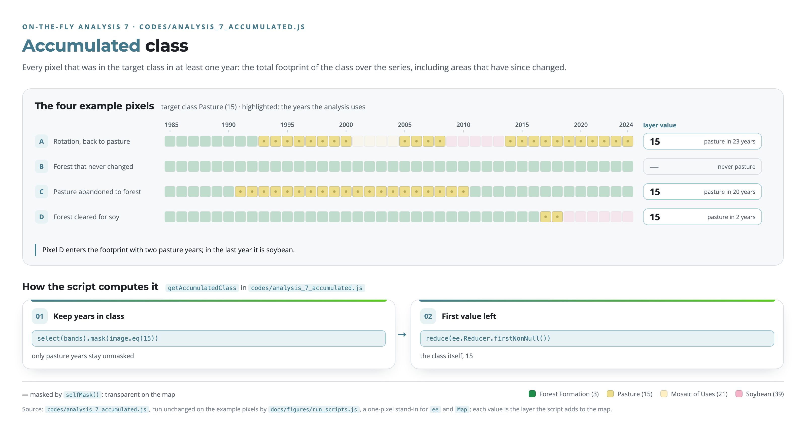
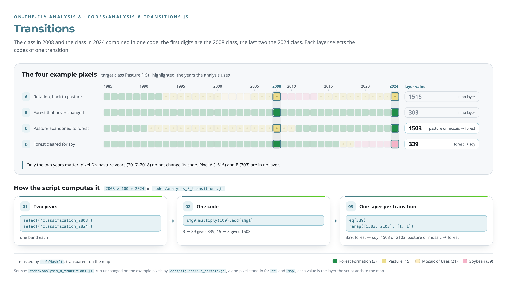

# Analysis implemented on-the-fly in the MapBiomas Platform

The JavaScript scripts provided in this repository are specifically designed for use within the Google Earth Engine (GEE) Code Editor. To utilize these tools, simply copy the code from the desired .js file and paste it directly into the GEE web interface. These scripts leverage the MapBiomas API and Earth Engine's distributed computing power to perform advanced temporal analysis of Land Use and Land Cover (LULC) dynamics, allowing for seamless replication of the environmental metrics described in this documentation.

All scripts read the MapBiomas Brazil Collection 10.1 coverage asset, where each pixel holds one land cover class per year in bands `classification_1985` to `classification_2024`. Analyses 1 to 7 reduce that 40-year series to a single value per pixel; analysis 8 compares two years. The class of interest is set by `targetClass` at the top of each script (15, Pasture, by default). Pixels whose result is zero are masked with `selfMask()` and appear transparent on the map.

The figures below run each script on the same four example pixels:

<picture>
  <source media="(prefers-color-scheme: dark)" srcset="docs/figures/overview-dark.png">
  
</picture>

**1. Class Age**

*Description:* Counts the consecutive years the pixel has belonged to the `targetClass`, going back from the last year of the series (2024). Any year in another class resets the count to zero, so only pixels that are in the target class in 2024 have an age.

*What it shows:* It separates "old" from "recent" areas. If the class is Pasture, a high value marks consolidated pasture and a low value a recent conversion. In the example, pixel A was pasture for 23 years in total, but its age is 11: only the years since 2014 count, because the soybean years broke the run. Pixels C and D are no longer pasture in 2024 and have no age.

<picture>
  <source media="(prefers-color-scheme: dark)" srcset="docs/figures/analysis_1_age-dark.png">
  
</picture>

**2. Class Frequency**

*Description:* Counts the total number of years the pixel was classified as the `targetClass` throughout the time series (1985–2024), consecutive or not.

*What it shows:* Unlike "Age," frequency does not require consecutive years, so it reveals the recurrence of a class. A pixel can have a low age and a high frequency when the class disappears and comes back, as in crop rotation or shifting cultivation. In the example, pixel A has a frequency of 23 (in three blocks) and an age of 11; pixel C, 20 years of pasture that ended in 2010, still has a frequency of 20.

<picture>
  <source media="(prefers-color-scheme: dark)" srcset="docs/figures/analysis_2_frequency-dark.png">
  
</picture>

**3. Number of Distinct Classes**

*Description:* Counts how many different classes have occupied the pixel over the 40 years. A class that appears in several separate periods counts once.

*What it shows:* It is a proxy for land use diversity. A pixel with a value of 1 has always been the same class; a higher value means it went through that many categories. In the example, pixel A went through Forest, Pasture, Mosaic of Uses and Soybean (4 classes), and pixel C, which returned to forest, has only 2.

<picture>
  <source media="(prefers-color-scheme: dark)" srcset="docs/figures/analysis_3_number_of_classes-dark.png">
  
</picture>

**4. Number of Changes**

*Description:* Counts how many times the class changed from one year to the next, as the number of runs (blocks of consecutive years with the same class) minus one. Pixels that never changed are masked.

*What it shows:* It measures landscape dynamism: high values indicate instability or frequent "flipping" between classes. Leaving a class and returning to it counts twice, so a pixel that goes from Forest to Pasture and back to Forest (pixel C in the example) has 2 changes but only 2 classes. Pixel A has 5 changes among 4 classes.

<picture>
  <source media="(prefers-color-scheme: dark)" srcset="docs/figures/analysis_4_number_of_changes-dark.png">
  
</picture>

**5. Stable Classes**

*Description:* Keeps only the pixels that had the same class in every year from 1985 to 2024, with that class as their value; every other pixel is masked.

*What it shows:* These are the "remnants" or "climax" areas: primary forests or long-term consolidated land uses that never changed. A single year in another class is enough to remove a pixel: in the example, pixel D was forest for 32 years but is not stable because of two pasture years. Only pixel B is stable, with class 3 (Forest Formation).

<picture>
  <source media="(prefers-color-scheme: dark)" srcset="docs/figures/analysis_5_stable-dark.png">
  
</picture>

**6. Class Last Year**

*Description:* Returns the most recent year in which the pixel was classified as the `targetClass`.

*What it shows:* It maps the temporal footprint of a class: where a class is no longer present, it tells when it was last seen. In the example, pixel C left pasture in 2010 and pixel D in 2018; pixel A is still pasture, so its value is the last year of the series, 2024.

<picture>
  <source media="(prefers-color-scheme: dark)" srcset="docs/figures/analysis_6_last_year-dark.png">
  
</picture>

**7. Accumulated Class**

*Description:* Marks every pixel that was classified as the `targetClass` in at least one year of the series (1985–2024), with the target class as its value.

*What it shows:* It maps the total footprint or "historical reach" of a land use, including areas that have since been abandoned or converted. In the example, pixels A, C and D are all in the pasture footprint, even though D was pasture for only two years and is soybean in 2024. It is a tool for analyzing the maximum expansion or the total area ever affected by a land cover type.

<picture>
  <source media="(prefers-color-scheme: dark)" srcset="docs/figures/analysis_7_accumulated-dark.png">
  
</picture>

**8. Transitions**

*Description:* Combines the class of 2008 and the class of 2024 in a single code by map algebra, `class_2008 × 100 + class_2024`: the first digits are the 2008 class and the last two the 2024 class. Each map layer then selects the codes of one transition of interest; other codes are transparent. Only the two years are compared: what happens in between does not change the code.

*What it shows:*
- Forest → soy: Forest (class 3) converted to Soybean (class 39) gives code 339 (pixel D in the example).
- Pasture or mosaic → forest: Pasture (15) or Mosaic of Uses (21) back to Forest (3) gives codes 1503 or 2103, grouped in one layer (pixel C in the example).

Pixels A (1515) and B (303) match neither transition and do not appear in either layer.

<picture>
  <source media="(prefers-color-scheme: dark)" srcset="docs/figures/analysis_8_transitions-dark.png">
  
</picture>

## Figures

The figures are generated by [`docs/figures/build_figures.py`](docs/figures/build_figures.py), which runs the scripts in `codes/` unchanged on the example pixels, so the values shown are the layers the scripts produce. To rebuild them (needs Node and Google Chrome):

```
python docs/figures/build_figures.py                  # all figures
python docs/figures/build_figures.py analysis_1_age   # one figure
```

A new analysis gets its own figure by adding an entry to `ANALYSES` in that script.
